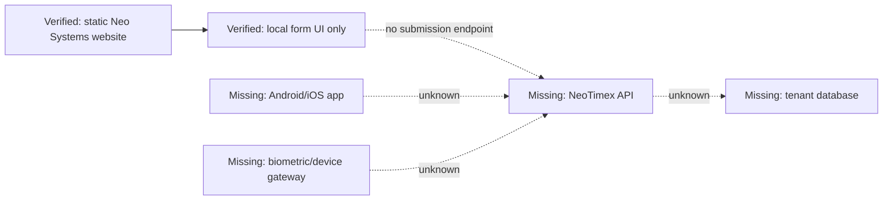
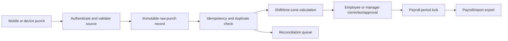

# NeoTimex Project Understanding and India Launch Readiness

**Assessment date:** 11 November 2026  
**Repository assessed:** `C:\Users\prain\Documents\ChatGPT\neosys website`  
**Assessment boundary:** This repository contains a static Neo Systems marketing website. It does **not** contain the NeoTimex mobile application, application programming interface (API), backend service, database, biometric gateway, device connector, deployment configuration, or automated test suite. Conclusions about those systems are therefore intentionally limited.

## Evidence-status key

- **Implemented and verified:** observed directly in this repository.
- **Partially implemented:** observed, but incomplete for the stated purpose.
- **Documented but not verified:** public copy or a planning statement, without implementation evidence.
- **Missing from assessed repository:** no relevant source or configuration was found here.
- **Requires a business decision:** scope, policy, commercial, or legal decision needed before implementation can be assessed.

## 1. Executive overview

NeoTimex is presented as a proposed mobile-based, cost-conscious time-attendance product. The public site positions it for organisations that want a simpler mobile-first attendance conversation, but explicitly says that feature scope, supported workflows, devices, and commercial terms are still to be defined (`neotimex.html:34-59`).

The only verified usable product in this repository is a static marketing website. It presents pages, responsive navigation, a non-operational enquiry interface, SEO metadata, and draft legal pages. The contact form is intentionally prevented from sending data and tells the visitor that routing will be enabled later (`script.js:99-116`). No attendance, login, employee, company, database, GPS, biometric, subscription, or billing functionality is present.

**Preliminary readiness verdict:** **prototype / pre-product marketing site**, not ready for an internal attendance pilot, paid customer pilot, or production launch.

**Confidence:** High for the website finding; very low for any conclusion about NeoTimex itself because its source repositories are absent. The practical next step is to locate the mobile, backend, device-gateway, database, infrastructure, and CI/CD repositories before authorising a customer pilot.

### Major obstacles to a paid pilot

1. The actual application and data-processing implementation are unavailable for review.
2. No verified attendance calculation, multi-tenant isolation, security, device integration, or recovery workflow exists in the assessed repository.
3. The current public privacy and terms pages state they are pre-launch structures, not final legal notices (`privacy.html:15-20`; `terms.html`, analogous draft page).
4. The public contact workflow does not submit enquiries and contact channels are pending approval (`contact.html:41-51`; `script.js:93-115`).
5. Product claims, supported platforms, attendance methods, pricing, onboarding, and data/privacy posture remain approval items (`CONTENT_APPROVAL.md:5-10`).

## 2. Repository and technology map

| Component | Technology | Purpose | Evidence | Concerns |
|---|---|---|---|---|
| Public website | Static HTML, CSS, browser JavaScript | Marketing pages for Neo Systems and NeoTimex | `index.html`, `neotimex.html`, `styles.css`, `script.js` | Not an application backend; no server-side processing. |
| Navigation / visual interaction | Vanilla browser JavaScript | Mobile menu, generated footer, scroll reset, static contact markup | `script.js:1-117` | The script assumes elements exist; no application error handling or telemetry. |
| NeoTimex product content | Static HTML | Describes a product direction only | `neotimex.html:34-59` | Explicitly says details remain to be confirmed. |
| Enquiry form | Browser-side form interception | Displays a non-submitting status message | `script.js:99-116` | No API, validation beyond browser-required fields, spam control, storage, or routing. |
| Database / API / jobs / notifications | Missing from assessed repository | Would run the attendance product | No source, schemas, migrations, manifests, or deployment files found | Cannot assess security, correctness, scale, or operations. |
| Mobile application | Missing from assessed repository | Would collect attendance punches | No Android/iOS/Flutter/React Native source found | Cannot assess permissions, token storage, offline behaviour, or store readiness. |

There is no `package.json`, `composer.json`, mobile build file, container definition, infrastructure-as-code file, database migration, SQL schema, environment example, or test directory at the repository root. The `tmp/` folder contains authoring artifacts from this workspace and is not evidence of the product architecture.

## 3. Product workflows

No end-to-end attendance workflow is implemented or verifiable here. The following table separates the marketing evidence from the missing product implementation.

| Workflow | Status | What is evidenced | Missing evidence needed for assessment |
|---|---|---|---|
| Company onboarding / configuration | Missing | None | Tenant creation, branch/site configuration, admin roles, audit log. |
| Employee onboarding / login / recovery | Missing | None | Account lifecycle, identity proofing, password/OTP policy, session invalidation. |
| Punch-in / punch-out | Documented but not verified | “Mobile-based attendance workflow” (`neotimex.html:48-49`) | Mobile screens, API, event model, time source, failure handling. |
| GPS, geofence, selfie, biometric, device source | Requires a business decision | The site names no method | Product requirements and implementation evidence. |
| Calculations, corrections, approvals, reports, payroll export | Missing | None | Rules engine, raw-punch storage, calculation records, approvals, exports. |
| Leave, shifts, overtime, holidays, notifications | Missing | None | Domain model, user interface, jobs, test coverage. |
| Exit and access removal | Missing | None | Deactivation, retention/deletion, device access revocation. |

### Architecture diagram - evidence boundary

### Attendance-processing flow - required future design

This is a recommended design, not an observed implementation.

## 4. Feature inventory and gaps

| Feature | Current status | Evidence | Gap | Priority | Recommended release |
|---|---|---|---|---|---|
| Employee / department management | Missing | No application source | Full tenant-scoped CRUD and audit history | P0 | Paid pilot |
| Companies, branches, sites, managers | Missing | No schema/API | Multi-tenant hierarchy and scoping | P0 | Paid pilot |
| Role-based permissions | Missing | No auth code | Admin, manager, employee and support authorization | P0 | Paid pilot |
| Mobile attendance | Documented but not verified | `neotimex.html:48-49` | Actual workflow, API, event handling | P0 | Paid pilot |
| Shifts / overnight / rotating shifts | Missing | No evidence | Calculation engine and edge-case tests | P0 | Paid pilot |
| Grace, late, early, half day, breaks, overtime | Missing | No evidence | Configurable policy engine | P1 | Paid pilot |
| Weekly offs / holiday calendars | Missing | No evidence | Company and state/site calendars | P1 | Paid pilot |
| Leave and approvals | Missing | No evidence | Balances, rules, approval workflow | P2 | Wider launch |
| Regularisation and audit history | Missing | No evidence | Immutable history and approval controls | P0 | Paid pilot |
| Reports and payroll export | Missing | No evidence | Reconciled exports and documented mappings | P0 | Paid pilot |
| Bulk import/export | Missing | No evidence | Secure import validation and export authorization | P1 | Paid pilot |
| Subscription / billing | Missing | Pricing is marketing material only | Customer plans, invoices, entitlement checks | P2 | Wider launch |

## 5. Attendance accuracy and edge cases

No attendance logic is available to test. Payroll-affecting attendance must not be launched until the following are designed, implemented, and covered by automated tests:

- Store every received punch as an immutable raw event with tenant, employee, source, source-event identifier, event time, received time, and device/app metadata.
- Enforce idempotency: the same device event or mobile retry must not create a second attendance result.
- Store time in Coordinated Universal Time (UTC), keep the supplied device time separately, and display/calculates against the relevant India time zone (`Asia/Kolkata`) unless a tenant/site setting requires otherwise.
- Make overnight-shift date assignment explicit. For example, a 22:00-06:00 shift needs a documented policy for which attendance date owns the exit punch.
- Allow missing/multiple punches to enter an exception queue; do not silently invent a checkout time.
- Freeze approved or payroll-locked periods. Corrections afterward must create a controlled adjustment and audit trail, not silently rewrite history.
- Reprocess derived attendance from raw punches in a versioned, reversible manner. Do not corrupt approved results.
- Reconcile raw events with calculated attendance and flag unmapped employee/device events.

Without these safeguards, duplicate, late, offline, or wrongly ordered events can affect salary, overtime, leave, and employee trust.

## 6. Mobile application review

**Status: not assessable.** No mobile project, app package, build configuration, signing configuration, dependency lock file, source code, permission declaration, crash-reporting configuration, or release pipeline is in this repository.

Before launch, verify on real low-cost Android devices and any supported iPhones:

- Supported operating-system versions and reproducible release builds.
- Short-lived session tokens, secure device storage, logout, and forced session revocation.
- Just-in-time location permission explanation and a clear distinction between a one-time punch location and continuous tracking.
- GPS accuracy, geofence tolerance, denied-permission path, mock-location/spoofing limitations, and manual review policy.
- Offline queue encryption, retry/backoff, stable event identifiers, conflict handling, and ordered synchronization.
- Battery, background restrictions, weak-network behaviour, accessibility, readable errors, and Indian language requirements.
- App signing ownership, Play Console/App Store Connect ownership, Data safety/App Privacy declarations, privacy policy, crash reporting, update/rollback strategy.

Google Play requires accurate Data safety disclosures and a publicly accessible privacy policy; the declaration covers third-party software development kits (SDKs) too. [Google Play Data safety guidance](https://support.google.com/googleplay/android-developer/answer/10787469?hl=en) (accessed 11 November 2026). Apple requires review information and, where location is used, a clear privacy explanation and secure handling. [Apple location guidance](https://developer.apple.com/documentation/corelocation/configuring-your-app-to-use-location-services) (accessed 11 November 2026).

## 7. Device and biometric integrations

**Status: not assessable.** No eSSL, eBioServer, SDK, push/polling connector, device gateway, configuration, or device-event schema was found.

Do not claim biometric support until the source is reviewed. A biometric device may send only an employee identifier and timestamp; that is materially different from storing biometric templates or face images. The product must document which it does, which party controls the device, how employee identifiers map to user accounts, how clocks are synchronized, and how duplicate/backfilled events are reconciled.

For a paid pilot, require a gateway deployment guide covering device authentication, encryption, least-privilege database/API credentials, connectivity health, local buffering, retry, duplicate handling, historical backfill, and support ownership.

## 8. Data model and multi-tenant isolation

**Status: missing from assessed repository.** No entities, indexes, migrations, database queries, object-storage configuration, or background jobs can be reviewed.

Minimum data-model separation should include tenant/company, branch/site, employee, role assignment, shift policy, raw punch, calculated attendance, correction, approval, payroll lock, device, audit event, file, and subscription entitlement. Every query, export, file retrieval, API action, asynchronous job, and support tool must enforce a tenant scope server-side. Client-side filtering is not tenant isolation.

High-risk scenarios that must be tested once source is available: changing an employee identifier between companies, guessing an export/file URL, a queued job running without tenant context, support impersonation, and a cross-tenant report or bulk import.

## 9. Security and privacy

| Finding | Evidence | Business impact | Severity | Recommended fix |
|---|---|---|---|---|
| Backend security cannot be assessed | Backend source/configuration absent | Cannot state whether employee data is protected | Critical evidence gap | Obtain all service, infrastructure, secret-management and security-test evidence. |
| Final privacy notice is absent | `privacy.html:15-20` calls itself pre-launch | Cannot make informed employee disclosures | P0 | Publish counsel-reviewed notice, in-app notice, retention/deletion process and privacy contact. |
| Terms are draft | `terms.html` is pre-launch / noindex | Commercial responsibilities and support terms unclear | P1 | Finalise customer terms, data-processing terms, SLA and acceptable-use terms. |
| Contact form does not transmit data | `script.js:113-115` | No lead capture; no production data collection yet | Low now; P1 before website launch | Implement secured server-side processing, consent/notice, anti-spam and retention controls. |
| Admin MFA / authorization / rate limits unverified | No app or API source | Account takeover or data exposure cannot be assessed | Critical evidence gap | Require design and code review, MFA for privileged users, authorization tests, throttling and security logging. |

India's Digital Personal Data Protection Act, 2023 and the notified Digital Personal Data Protection Rules, 2025 should be reviewed with counsel against the exact launch date and processing model. The Rules use phased commencement, so legal obligations must be mapped to applicable dates rather than assumed. [MeitY Rules page](https://www.meity.gov.in/documents/act-and-policies/digital-personal-data-protection-rules-2025-gDOxUjMtQWa?pageTitle=Digital-Personal-Data-Protection-Rules-2025) and [official Gazette text](https://www.meity.gov.in/static/uploads/2025/11/53450e6e5dc0bfa85ebd78686cadad39.pdf) (accessed 11 November 2026).

## 10. India market and regulatory readiness

### Suitable initial segment

Start with 2-5 local small/medium organisations (50-200 employees) with one or a few fixed sites, a simple weekday/shift policy, and a named payroll owner. Warehouses, small manufacturing sites, clinics, schools, and multi-outlet retail are suitable only after confirming their policy complexity and device requirements.

### Verified requirements / current-policy checks

- The precise DPDP duties and effective dates require counsel review against the 2025 Rules' phased commencement; do not present the product as “DPDP compliant” without implementation and contract evidence.
- Google Play requires an accurate Data safety declaration and a public privacy policy for published apps; account-creation apps also need an accessible account-deletion method. [Google Play policy](https://support.google.com/googleplay/android-developer/answer/18265346?hl=en) (accessed 11 November 2026).
- GST registration, invoicing and e-invoicing applicability depend on the legal seller, turnover, transaction type, and current thresholds. Verify the commercial model with a chartered accountant before invoicing.

### Customer/procurement expectations

- Written data-processing responsibilities, support hours, escalation path, backup/restore commitments, and exit/deletion terms.
- Clear employee notice for attendance, location, face/selfie, or biometric data, with an alternative procedure where required by policy or law.
- Configurable site/state holiday calendars, attendance policies, payroll period lock, and export mapping.
- Disclosure of hosting region, subprocessors, device vendors, and any third-party notification provider.

### Requires legal or payroll specialist review

State-specific employment/leave/holiday rules, biometric/labour requirements, lawful basis and notice/consent design, retention periods, payroll calculations, customer contract allocation, and data-transfer/residency commitments.

## 11. Production architecture and operations

The current hosting approach cannot be assessed: no hosting, CI/CD, domain configuration, TLS configuration, deployment descriptors, monitoring, database, queue, or backup artefacts exist.

For a small team, use separate development, staging, and production environments; a managed relational database; encrypted object storage; a queue for device/mobile retries and notifications; central structured logs with tenant/request IDs; error tracking; daily encrypted backups; and a tested restore procedure. Use versioned database migrations, release approvals, a rollback plan, and a runbook for failed attendance processing. These are recommendations, not observed controls.

## 12. Performance, scale, and cost

No performance measurements or cost configuration are available. The following are planning estimates only, assuming two punches per employee per working day, 26 working days/month, and a fourfold peak around shift change:

| Scenario | Employees | Approx. punches/month | Design implication |
|---|---:|---:|---|
| 10 customers x 100 employees | 1,000 | 52,000 | Small managed database can be sufficient, but tenant isolation and backup tests still matter. |
| 100 customers x 200 employees | 20,000 | 1,040,000 | Queue ingestion, indexed event tables, rate limits, observability and report isolation become essential. |
| 500 customers x 200 employees | 100,000 | 5,200,000 | Partitioning/retention strategy, asynchronous reports, capacity tests and mature on-call operations are needed. |

Load-test at least normal traffic, peak-shift traffic, delayed offline synchronization, a device backfill, report generation during peak, and reprocessing of a payroll period. Cost should be modelled as formulas using measured database storage, log/trace retention, file storage, SMS/OTP volume, push/notification provider pricing, device-gateway hosting, monitoring, and support hours. Current vendor quotations are required before publishing a cost estimate.

## 13. Quality and test coverage

No application tests or test configuration were found. No application test was run because the source is absent. The static site has no visible test suite or build manifest.

Priority test suite for the application:

1. Shift calculations including overnight, multiple/missing punches, grace periods, holidays, weekly offs, and payroll locks.
2. Duplicate device/mobile events and offline retry/idempotency.
3. Tenant isolation and permissions across APIs, exports, files, jobs and support tools.
4. Payroll-export reconciliation against approved attendance.
5. Backup restore, migration rollback, mobile rollback, and release rollback.
6. Peak shift-change traffic, device outage/recovery, and delayed event ordering.

## 14. Prioritized enhancement backlog

| ID | Finding / feature | Evidence | Customer impact | Priority | Effort | Dependencies | Acceptance criteria |
|---|---|---|---|---|---|---|---|
| P0-01 | Obtain and assess all product repositories | This repository is static only | Cannot safely run pilot without evidence | P0 | Small | Repository owners/access | Mobile, API, gateway, database, infra and CI/CD sources mapped. |
| P0-02 | Tenant-scoped auth and authorization | No implementation available | Cross-customer data exposure risk | P0 | Large | Backend/data model | Automated tests prove tenant isolation for APIs, exports and jobs. |
| P0-03 | Immutable raw-punch and idempotent calculation design | No implementation available | Incorrect payroll attendance | P0 | Large | Backend/mobile/device sources | Duplicate/retry/overnight tests pass; approvals are not overwritten. |
| P0-04 | Final privacy, employee notice and deletion process | `privacy.html:15-20` is draft | Privacy and store-launch blocker | P0 | Medium | Legal/business decision | Published notices, in-app disclosures, rights/deletion workflow approved. |
| P0-05 | Pilot observability and recoverability | No operational evidence | Failure cannot be detected/recovered | P0 | Medium | Hosting/DevOps | Alerts, backups and restore drill documented and tested. |
| P1-01 | Shift, holiday, correction and payroll-lock rules | Missing | Pilot may calculate attendance incorrectly | P1 | Large | Product/payroll policy | Pilot policies configurable and audit-tested. |
| P1-02 | Secure mobile offline flow | Missing | Field users lose or duplicate punches | P1 | Large | Mobile/API | Offline events retry safely with stable IDs and user-visible status. |
| P1-03 | Device-gateway integration guide | Missing | Device data may be unreliable | P1 | Medium | Device vendor access | Clock sync, buffering, mapping and reconciliation proven. |
| P2-01 | Leave / overtime / bulk import / billing | Missing | Limits broader commercial suitability | P2 | Medium-Large | Product prioritisation | Feature-specific acceptance tests and operational runbooks. |
| P3-01 | Advanced analytics and differentiation | Missing | Not required for reliable first pilot | P3 | Medium | Validated core product | Customer-backed use case and measurable adoption. |

## 15. Pilot and launch roadmap

| Phase | Deliverables | Owner roles | Exit criteria |
|---|---|---|---|
| Understand and stabilise | Repository map, architecture decision record, data map, security/threat review, attendance rules | Architect, product owner, developer | All missing sources obtained; pilot scope agreed. |
| Close critical gaps | P0 work, privacy/contract draft, test automation, monitoring/backups | Engineering, QA, DevOps, legal | P0 acceptance criteria met and restore drill succeeds. |
| Controlled customer pilot | 2-5 customers, configured policy templates, support runbook, weekly reconciliation | Product, customer success, payroll specialist | Recommended: >99.5% reconciled punch ingestion, no unresolved cross-tenant/security defect, defined support workload, customer sign-off. |
| Commercial operations | Pricing/entitlements, invoice process, onboarding checklist, incident process, app-store materials | Operations, finance, legal, support | Contract, invoicing and support ownership confirmed. |
| Expand with evidence | Add customers/segments gradually; perform capacity and security reviews | Leadership, engineering, QA | Pilot metrics and willingness to pay support expansion. |

The numerical success targets above are recommendations, not measured product performance.

## 16. Go-live checklist and final verdict

### Internal pilot

- [ ] All application repositories assessed and a known build can be reproduced.
- [ ] Authentication, tenant isolation, raw punches, calculation rules, audit history and backups are implemented and tested.
- [ ] Privacy/employee notice and location/biometric policy are approved.
- [ ] Monitoring, error tracking and a restore drill are complete.

### Paid customer pilot

- [ ] Internal-pilot criteria met.
- [ ] Customer agreement, data-processing terms, support contacts and escalation path signed.
- [ ] Customer shift, holiday, approval and payroll-export rules configured and reconciled.
- [ ] Security review, mobile permission disclosure, data deletion/exit process and device integration tests completed.

### Wider production launch

- [ ] Paid-pilot success evidence reviewed.
- [ ] Capacity/load tests and incident response exercised.
- [ ] Store listing, privacy disclosures, Data safety/App Privacy, signing ownership and release rollback confirmed.
- [ ] Customer onboarding, billing, support and SLA operations are staffed.

### Top 10 actions in order

1. Locate the NeoTimex mobile, backend, device-gateway, database, and deployment repositories.
2. Freeze the first paid-pilot scope and explicitly decide the attendance sources: mobile, GPS, selfie, biometric device, or a subset.
3. Document the raw-punch, timezone, overnight-shift, correction and payroll-lock rules.
4. Prove tenant isolation and privileged-access controls with tests.
5. Implement and test idempotent punch ingestion/reconciliation.
6. Finalise privacy notice, employee notice, retention/deletion, contracts and support commitments with counsel.
7. Establish development/staging/production separation, backup/restore and observability.
8. Complete mobile permission/offline/security review and store submission evidence.
9. Select 2-5 low-complexity pilot customers and reconcile their payroll outputs weekly.
10. Expand only after pilot accuracy, reliability, support workload and willingness-to-pay evidence is positive.

### Business decisions needed

- Which attendance methods are in scope for version one?
- Is location captured only at punch time, or continuously? What is the employee alternative if location is unavailable?
- Does the product store biometric templates/images, or only device identifiers and punch events?
- Which payroll systems and Indian states are supported in the pilot?
- What retention, deletion, support hours, availability target and data-hosting commitment will be sold?
- Who is the legal data controller/processor in the customer contract and who owns Play/App Store accounts?

### Questions for the current developer

- Where are the mobile, API, device integration, database migration, infrastructure and CI/CD repositories?
- How is tenant identity enforced in every API, query, export, storage path and queued job?
- How are raw punches, duplicate events, offline retries, device times, UTC, overnight shifts and payroll locks handled?
- What automated tests, security tests, backups, restore tests, monitoring and production incidents exist?
- Which third-party SDKs collect or receive employee, location, selfie, device or biometric-related data?

### Missing access required for further verification

Source repositories, deployment accounts/read-only configuration, architecture diagrams, API specification, database schema/migrations, mobile signing and store metadata, device manuals/SDKs, test results, anonymised logs, backup/restore evidence, sample customer contract, privacy notice, payroll export specifications, and support runbooks.

## Final conclusion

NeoTimex cannot be assessed as a functioning time-and-attendance platform from this repository. What is present is a well-formed marketing-site draft that deliberately avoids unsupported product claims. Its own content confirms NeoTimex details are still to be defined (`neotimex.html:57-59`) and the content-approval list identifies product, privacy, pricing and platform questions still open (`CONTENT_APPROVAL.md:5-10`). The correct readiness classification is **pre-product / marketing prototype**. The conclusion would change only after the actual application and operational evidence are provided and the P0 controls are demonstrated.
